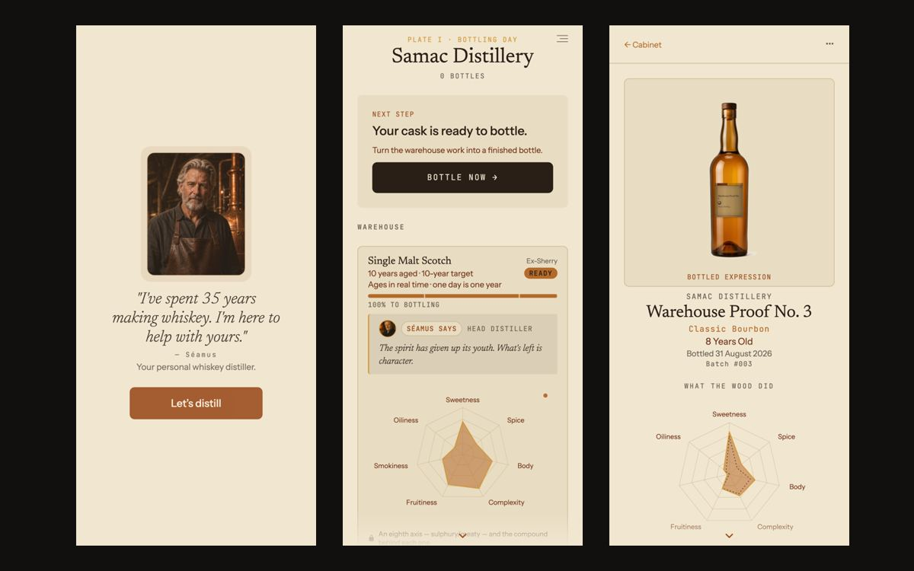

# Distill by Stillbound

**Most whiskey apps are notebooks. They record what you drank. Distill lets you make the whiskey, then explains why it tastes the way it does.**

## What it does

- Takes you from grain to glass through seven stations: grain bill, fermentation, still, cut, cask, char and years in wood.
- Moves the flavour when you move a lever. A long fermentation builds fruit. A late cut carries oil and weight. First-fill sherry gives you more than refill.
- Ages your cask in real time. One day in your life is one year in the barrel. A twelve year single malt takes twelve days.
- Offers poitin for the impatient. Ireland's unaged spirit needs no cask, so you can bottle your first one tonight.
- Tells you why the result tastes that way, in plain language, grounded in real distilling science.

## How it was built

Built solo with AI coding agents, starting April 2026. Live on the App Store since September 2026.

Stack: React Native, Expo, TypeScript.

## Try it

- iOS app: [Distill by Stillbound on the App Store](https://apps.apple.com/us/app/distill-by-stillbound/id6790754014)

Source: private.

---

Built by John Robinson · [Stillbound.ai](https://stillbound.ai)
